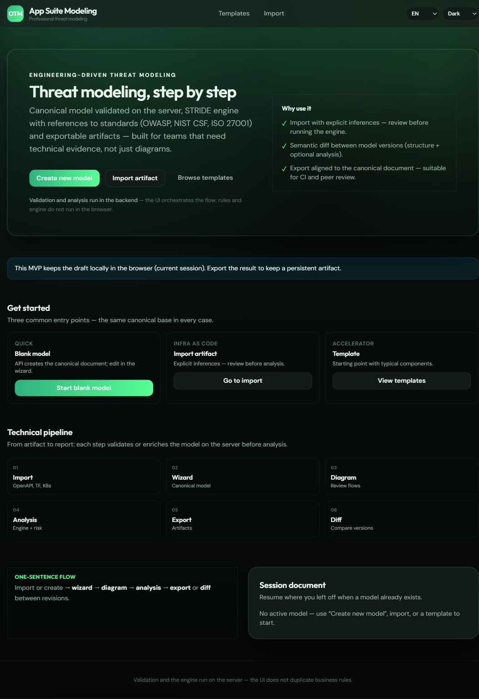
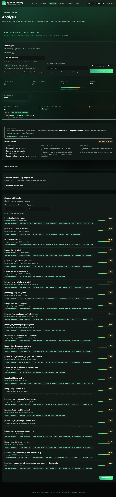

# App Suite Modeling

**Threat modeling as code for teams that ship software.**  
Define architecture once in a **versioned YAML model**, run **multi-methodology analysis**, and plug outputs into **reviews, pipelines, and auditors**—without duplicating logic across diagrams and spreadsheets.

[](LICENSE)
[](https://www.python.org/)
[](https://nodejs.org/)

> **Python distribution name:** `open-threat-model` (see [`pyproject.toml`](pyproject.toml)). **App Suite Modeling** is the product name in docs and the web UI. Install from a clone: `pip install -e ".[cli]"` (or `.[dev,cli,api]` for full dev parity).

> **CI:** When the repo is public, add a workflow badge for [`.github/workflows/github-ci-cd.yml`](.github/workflows/github-ci-cd.yml) (replace `OWNER/REPO` in the shield URL).

---

## What is this?

**App Suite Modeling** is an open-source **threat modeling** toolkit built around a **canonical document** (`.otm.yaml` / JSON): components, trust boundaries, data flows, and assets. The same document powers:

- a **CLI** (`otm`) for automation,
- a **REST API** ([FastAPI](https://fastapi.tiangolo.com/)) for integrations,
- and a **web UI** (React + Vite) for guided modeling and visualization.

The **threat engine** validates the model and produces **suggested threats**, **structured explainability**, **remediation-style backlog hints**, and **exports** (Markdown, JSON, Mermaid, optional PDF). You can **import** drafts from real engineering artifacts (OpenAPI, Kubernetes manifests, Terraform, Helm) and **diff** two model revisions for PR-style reviews.

It is aimed at **AppSec**, **DevSecOps**, and **software architects** who want models that stay **close to the repo**, **reviewable in Git**, and **repeatable in CI**.

---

## Why this exists

Traditional threat modeling often **does not scale** with delivery:

- Diagrams and spreadsheets **drift** from the real system.
- Heuristics live inside **one** vendor tool or one analyst’s head.
- Outputs are **hard to version**, hard to diff, and awkward in **pull requests** or **tickets**.

This project treats the threat model as **code-like data**: one schema, many surfaces. You **validate** and **analyze** the same file from the terminal or API, attach **evidence-friendly artifacts** to reviews, and **re-run** analysis as the architecture changes—without re-implementing STRIDE (or other lenses) in each client.

---

## Key capabilities

| Area | What you get |
|------|----------------|
| **Model as code** | Canonical `.otm.yaml` / JSON validated against [`otm_core_schema`](packages/core-schema); fits Git and code review. |
| **Multi-methodology engine** | STRIDE, LINDDUN, PASTA, NIST Data-Centric, OCTAVE Allegro, CIA-DIE, **PLOT4ai** (AI/LLM systems). |
| **Explainability** | Structured explanation records alongside heuristics—not only free-text bullets. |
| **Semantic diff** | Compare models (and rich comparisons) for **PRs**, audits, and release gates. |
| **Artifact import** | Seed drafts from **OpenAPI/Swagger**, **Kubernetes YAML**, **Terraform**, **Helm** (always review the result). |
| **Exports** | JSON, Markdown, Mermaid, bundles; **PDF** generation in the browser for the web UI path; premium report path via optional extras. |
| **CI / automation** | Same operations via **CLI** or **REST** (`validate`, `analyze`, `export`, `diff`, templates, imports). |

Details: [Methodology matrix](docs/features/MULTI_ENGINE_ARCHITECTURE.md) · [Artifact import](docs/features/ARTIFACT_IMPORT.md) · [Exporters](docs/features/EXPORTERS.md) · [Diff](docs/features/THREAT_MODEL_DIFF.md)

---

## How it works (high level)

```text
Author model (.otm.yaml) → validate → analyze (methodology / auto-recommend)
    → review threats + explanations + backlog hints → export artifacts → diff versions
```

Optional: **import** OpenAPI/K8s/Terraform/Helm to bootstrap a draft, then **incrementally** refine in the **wizard** or editor and share via **API** or **CLI**.

---

## Architecture overview (short)

| Layer | Role |
|--------|------|
| **CLI** (`apps/cli`, Typer) | Local and CI workflows: `otm validate`, `analyze`, `report`, `diff`, `import`, templates. |
| **API** (`apps/api`, FastAPI) | HTTP access to the same capabilities; OpenAPI contract checked in CI. |
| **Web UI** (`apps/web`) | Guided flow, React Flow diagram, analysis, export, history in **browser storage** (no server-side session DB by default). |
| **Threat engine** (`packages/threat-engine`) | Methodology lenses, heuristics, PLOT4ai signals, scoring—**no** dependency on FastAPI/React. |
| **Schema** (`packages/core-schema`) | Single source of truth for a valid **OTM** document. |
| **Exporters / diagram / packs** | `packages/exporters`, `diagram-engine`, `industry-packs`, `framework-mappings`, etc. |

Deeper maps: [MONOREPO.md](docs/MONOREPO.md) · [REPOSITORY_LAYOUT.md](docs/REPOSITORY_LAYOUT.md) · [ARCHITECTURE.md](docs/architecture/ARCHITECTURE.md)

---

## Quick start

**Prerequisites**

- **Python 3.11+**
- **Node 20+** if you work on the web UI (matches CI)
- On Linux, full **dev** installs that pull PDF stacks may need **Cairo** dev packages (see [CONTRIBUTING.md](CONTRIBUTING.md))

**Install (CLI + API + dev tools, recommended for contributors)**

```bash
python -m venv .venv
# Windows: .venv\Scripts\activate
# Linux/macOS: source .venv/bin/activate

pip install -e ".[dev,cli,api]"
```

Use **`[dev,cli,api]`** so local runs match CI (API tests need `slowapi`, etc.). Minimal CLI-only: `pip install -e ".[cli]"`.

**Automated bootstrap** (venv + editable install + `npm install` in `apps/web`):

```bash
python scripts/setup_dev.py
```

**Run API + web together** (after setup):

```bash
python scripts/run_dev.py
```

- API: `http://127.0.0.1:8000` · OpenAPI UI: `/docs`  
- Web: `http://127.0.0.1:5173`

**Minimal CLI session**

```bash
otm validate examples/minimal.otm.yaml
otm analyze examples/minimal.otm.yaml --methodology stride
otm report examples/minimal.otm.yaml -o REPORT.md
```

---

## Example (real)

**Input** — excerpt from [`examples/minimal.otm.yaml`](examples/minimal.otm.yaml) (order API with user, API, worker, DB):

```yaml
model:
  schema_version: "1.1.0"
  system_type: web_application
  industry_sector: saas

metadata:
  title: "Exemplo — API de pedidos"
  summary: "Serviço REST com fila e banco."

components:
  - id: user
    name: "Usuário"
    kind: user
    in_trust_boundary: internet
  - id: api
    name: "API"
    kind: process
    in_trust_boundary: vpc
  # … trust_boundaries, data_flows, assets (see full file in repo)
```

**Commands**

```bash
otm validate examples/minimal.otm.yaml
otm analyze examples/minimal.otm.yaml --methodology stride
```

**Output (abridged)** — analysis summarizes methodology, crossings, and heuristic counts (exact numbers depend on engine version):

```text
| Exemplo — API de pedidos                                                      |
| Framework refs: ISO/IEC 27001 … · NIST CSF … · OWASP …                       |
| Structural warnings: 0                                                        |
| Methodology: stride                                                           |
| Cross-boundary flows: 1                                                       |
| Base heuristics: N new · 0 already covered                                    |
| Highest score (L×I): …                                                        |
```

`otm report … -o REPORT.md` produces a **Markdown report** you can attach to a PR or evidence pack.

---

## Screenshots

| Product overview | Analysis output |
|---|---|
| [](docs/screenshots/home.png) | [](docs/screenshots/analysis.png) |
| Landing: hero + primary CTAs (new model, import, templates). | Methodology selection, model metrics, and suggested threats with likelihood × impact scoring. |

Additional captures (a wizard step, export/PDF action, and a CLI session) land under [`docs/screenshots/`](docs/screenshots/README.md) as they are produced. Framing guide: [`docs/features/SCREENSHOT_GUIDE.md`](docs/features/SCREENSHOT_GUIDE.md).

---

## Use cases

- **AppSec programs** — Repeatable models, exports for review, traceable explanations.  
- **DevSecOps** — `otm` in pipelines; JSON/Markdown artifacts for tickets and gates.  
- **Architecture & design reviews** — Semantic **diff** across architecture versions.  
- **PR discipline** — Attach or generate artifacts from the same file the team changes.  
- **Audits** — Structured outputs and methodology alignment (see framework mapping docs).  
- **AI/LLM systems** — PLOT4ai lens for model/prompt/RAG/agent concerns.

---

## Maturity & limitations

**Be explicit about what this is not:** a **full multitenant SaaS** with built-in org accounts, centralized model history, or opinionated cloud hosting.

| Topic | Expectation |
|--------|-------------|
| **Core schema & engine** | **Stable** and heavily tested; **STRIDE** is the most mature lens; others vary (see [release scope](docs/internal/decisions/RELEASE_SCOPE_FREEZE.md)). |
| **CLI / OpenAPI** | **Stable** contracts for automation; breaking changes should be versioned and noted in [CHANGELOG](CHANGELOG.md). |
| **Web UI** | **Mature MVP**: full flow + diagram + exports; **persistence is browser/session-centric** by default—no server-side user DB in the default stack. |
| **API in production** | Optional **API key** and **rate limiting** exist; **internet-facing** deployments still need your **gateway, identity, and hardening** ([deployment notes](docs/architecture/DEPLOYMENT_INVARIANTS.md)). |
| **Import** | Produces **drafts**—humans must reconcile trust boundaries and sensitive data. |
| **Analysis** | **Heuristic / assistive**—not a completeness guarantee or formal proof. |

Full detail: [KNOWN_LIMITATIONS.md](docs/KNOWN_LIMITATIONS.md)

Test suite (reference): **400+** Python tests in CI when installing `.[dev,cli,api]`—see [CI workflow](.github/workflows/github-ci-cd.yml).

---

## Project structure (pointer)

- Layout & packaging: [docs/MONOREPO.md](docs/MONOREPO.md)  
- Layers and `otm_*` packages: [docs/REPOSITORY_LAYOUT.md](docs/REPOSITORY_LAYOUT.md)  
- How docs are organized: [docs/DOCUMENTATION_STRUCTURE.md](docs/DOCUMENTATION_STRUCTURE.md)

---

## Documentation

| Doc | Purpose |
|-----|---------|
| [docs/README.md](docs/README.md) | Doc hub & onboarding (including PT-BR oriented guides) |
| [docs/features/CLI.md](docs/features/CLI.md) | CLI reference |
| [docs/features/API.md](docs/features/API.md) | REST API & optional perimeter |
| [docs/features/UI.md](docs/features/UI.md) | Web app flows |
| [docs/features/MULTI_ENGINE_ARCHITECTURE.md](docs/features/MULTI_ENGINE_ARCHITECTURE.md) | Methodology matrix |
| [docs/features/CHOOSE_METHODOLOGY.md](docs/features/CHOOSE_METHODOLOGY.md) | Choosing a lens |
| [docs/features/PLOT4AI_AI_SYSTEM.md](docs/features/PLOT4AI_AI_SYSTEM.md) | PLOT4ai / AI modeling |
| [docs/features/ARTIFACT_IMPORT.md](docs/features/ARTIFACT_IMPORT.md) | Importing OpenAPI, K8s, Terraform, Helm |
| [docs/features/THREAT_MODEL_DIFF.md](docs/features/THREAT_MODEL_DIFF.md) | Model diff |
| [docs/features/EXPORTERS.md](docs/features/EXPORTERS.md) | Export formats |
| [docs/CI_AND_SECURITY_EVIDENCE.md](docs/CI_AND_SECURITY_EVIDENCE.md) | Security tooling & CI gates |
| [docs/features/PRODUCT_POSITIONING.md](docs/features/PRODUCT_POSITIONING.md) | Positioning narrative |
| [docs/features/BRANDING.md](docs/features/BRANDING.md) | Branding, palette, and visual system for maintainers |
| [docs/PROJECT_DEEP_DIVE.md](docs/PROJECT_DEEP_DIVE.md) | Long-form product & engineering overview |

Release assessment (maintainers): [FINAL_GO_NO_GO_RELEASE_ASSESSMENT.md](docs/internal/reports/FINAL_GO_NO_GO_RELEASE_ASSESSMENT.md)

---

## Contributing

Issues and PRs are welcome. Please read [CONTRIBUTING.md](CONTRIBUTING.md) and follow [CODE_OF_CONDUCT.md](CODE_OF_CONDUCT.md).  
Templates: [.github/ISSUE_TEMPLATE](.github/ISSUE_TEMPLATE) · [Pull request template](.github/pull_request_template.md)

---

## Security

Please **do not** file public issues with exploitable vulnerability details. Use the process in [SECURITY.md](SECURITY.md) (e.g. GitHub Security Advisories).

---

## Versioning

Package version lives in `pyproject.toml` (currently **7.6.4**, aligned with `apps/web/package.json`). Tags, RCs, and the relationship to historical milestones (e.g. documented `v0.1.0` scope) are explained in [docs/VERSIONING_AND_TAGS.md](docs/VERSIONING_AND_TAGS.md). Release history: [CHANGELOG.md](CHANGELOG.md).

---

## License

[MIT](LICENSE)

---

## Trademarks

*App Suite Modeling* is the project name. STRIDE, LINDDUN, PASTA, NIST, PLOT4ai, and other methodology names belong to their respective owners and are cited here to describe **supported lenses**, not affiliation.
