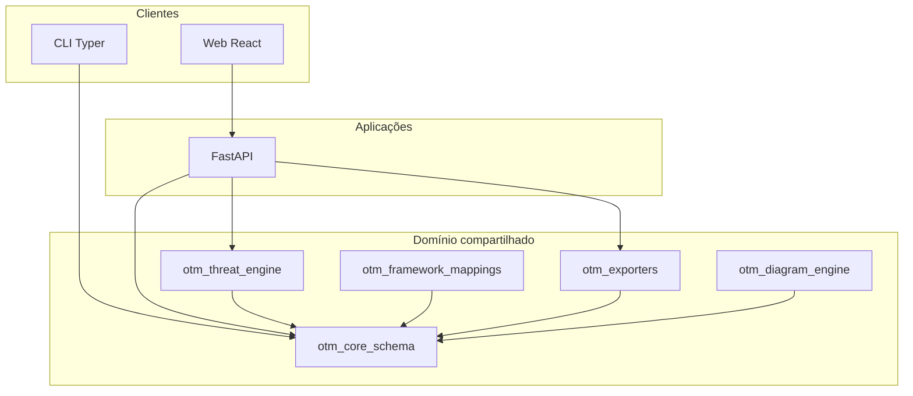

# Arquitetura base — Open Threat Model

## Visão em camadas

**Decisão:** uma única biblioteca de domínio (`otm_core_schema`) define o **contrato serializável** (YAML/JSON). CLI, API e UI **não reimplementam** regras: apenas orquestram chamadas, persistência e apresentação.

## Fonte da verdade

| Artefato | Papel |
|----------|--------|
| `ThreatModelDocument` (Pydantic) | Modelo canônico em memória; validação cruzada de referências. |
| `schema_version` em `model` | Evolução compatível por fases (migrações explícitas no futuro). |
| Arquivos `.otm.yaml` / JSON | Persistência humana e CI; diffs em PR. |

## Pacotes Python

| Pacote | Responsabilidade |
|--------|------------------|
| `otm_core_schema` | Tipos, validação, I/O YAML/JSON, JSON Schema derivado. |
| `otm_threat_engine` | STRIDE, heurísticas de trust boundary, geração de ameaças, score (sem HTTP). |
| `otm_framework_mappings` | Dados e funções puras OWASP/NIST/ISO → ligação a ameaças/mitigações. |
| `otm_exporters` | Saídas Markdown, Mermaid, etc.; **sem** alterar o modelo além de formatação. |
| `otm_diagram_engine` | Transformação documento → grafo (nós/arestas) para UI. |

## Aplicações

- **`otm_cli`**: comandos estáveis (`validate`, `export`, `analyze`…) importando apenas o core.
- **`otm_api`**: REST/OpenAPI; validação e operações que o front não deve duplicar.
- **`apps/web`**: React + React Flow; consome API e exibe o mesmo documento validado no servidor quando necessário.

## O que não fazer

- Lógica STRIDE ou cálculo de risco na UI.
- Exportadores que mutam silenciosamente o modelo canônico.
- Mapeamentos de framework apenas como “tags visuais” sem uso em relatórios ou filtros.

## Banco de dados (pós-MVP)

SQLAlchemy entra quando houver **multi-usuário, histórico e busca**. O desenho alvo: linhas armazenam **documento canônico versionado** (ou patches), não um segundo modelo divergente.
