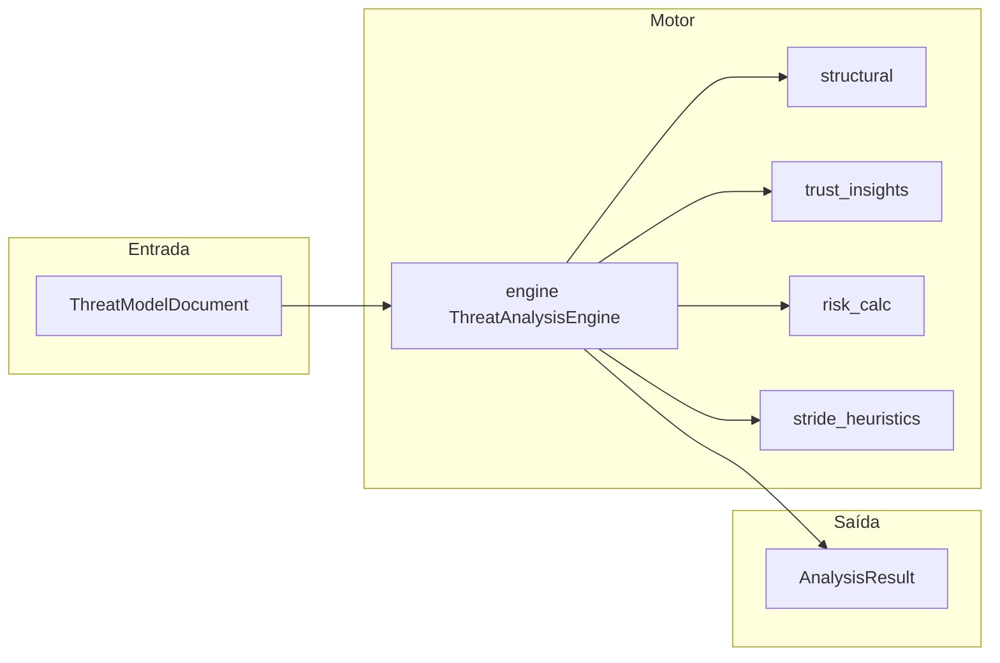

# Core engine (`otm_threat_engine`)

## Arquitetura interna

| Módulo | Função |
|--------|--------|
| `structural.py` | Avisos de consistência (não substitui Pydantic). |
| `trust_insights.py` | Fluxos entre fronteiras distintas. |
| `stride_heuristics.py` | Regras STRIDE por `ComponentKind` e fluxos. |
| `risk_calc.py` | Likelihood/impact heurísticos e score **L×I**. |
| `engine.py` | Orquestração e `AnalysisResult`. |
| `merge.py` | Opcional: grava heurísticas como `Threat` no documento. |
| `result.py` | Modelos Pydantic da saída (estável para API/CLI). |

**Parsing** permanece em `otm_core_schema.io`. **Exportação** em `otm_exporters`. O motor **não** depende de FastAPI nem de Typer.

## Consumo pela CLI

1. Carregar YAML com `load_document_from_yaml_path`.
2. Chamar `analyze_document(doc)` ou `ThreatAnalysisEngine().analyze(doc)`.
3. Imprimir `result.summary` e listar `result.heuristic_threats` (ou serializar `AnalysisResult` com `model_dump_json`).
4. Opcional: `merge_heuristic_threats` e gravar com `dump_document_to_yaml`.

## Consumo pela API

- Endpoint sugerido: `POST /analyze` com body = documento canónico (dict) → validar com `ThreatModelDocument` → `analyze` → devolver JSON de `AnalysisResult` (mesmo schema que a CLI pode mostrar).
- Versão do motor: campo `engine_version` em cada resposta.

## Extensão futura

Substituir ou complementar heurísticas por regras declarativas (YAML) sem alterar o formato de `AnalysisResult` — apenas o conteúdo de `heuristic_threats`.
